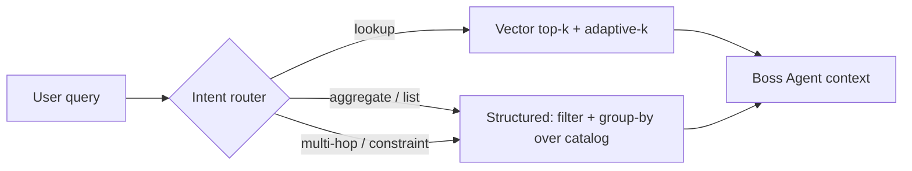

# Research note — Dynamic retrieval for the Boss Agent

_Status: research note / design proposal. Not yet implemented._
_Date: 8 October 2026._

## 1. Problem

The Boss Agent answers catalog questions with a single retrieval strategy:
`agent-service.ts` calls `RAGRetriever.retrieveSimilar(query, 4)` — a fixed
top-k = 4 over cosine similarity (`vector-store.ts`), with no score threshold
and no query routing. This works for factual lookups but fails on two query
classes observed in evaluation:

- **Aggregate / analytical** — _"which provider offers the most firewalls",
  "list every service in category Y"_. These need **all** matching records, or
  a count / group-by, not the 4 nearest.
- **Multi-hop / constraint** — _"a tool that does X, runs on Y, and is from
  provider Z"_. These need a **conjunction of attribute predicates**.

In the 2026-10-02 evaluation both classes scored **0/9** for the 14B local model
_and_ the 550B frontier model — i.e. the failure is not model capacity. The
retriever returns four services; a question that needs more cannot be answered,
and a larger generator does not help.

## 2. Diagnosis: a query-class mismatch, not a tuning problem

No value of `k` and no similarity threshold fixes this, because the failing
questions are not retrieval questions:

- Cosine top-k returns the records **nearest** to the query text. Aggregate
  questions need the **set of all matching** records, or an **aggregate** over
  them (count, max-by-group). Similarity search cannot express "all" or "how
  many" — the quantity is not in the ranking.
- The catalog is **structured**: every `Service` carries `provider`,
  `categoryId`, and `sectorId`. Embedding a service into one vector discards
  exactly the structure these questions query over.
- A fixed `k` is simultaneously **too large** for simple lookups (which need
  1–2 records) and **too small** for lists (which need all of a category).

A prior internal finding also rules out the naive fix: fixed cosine-score
thresholds do not separate relevant from irrelevant on this corpus (see the RAG
score observation in project memory). The corpus is small, so there are few
distinct scores and no stable cut point.

## 3. Prior art

Surveyed directions and their canonical references, with fit for a **small
(~30–80 record) structured catalog**.

### 3.1 Query-complexity routing (classify → choose strategy)

- **Adaptive-RAG** — Jeong, Baek, Cho, Hwang, Park, _NAACL 2024_
  ([aclanthology 2024.naacl-long.389](https://aclanthology.org/2024.naacl-long.389/)).
  A classifier labels each query (no-retrieval / single-step / multi-step) and
  routes it. _The routing idea is exactly what we need;_ its trained T5
  classifier targets hop-count rather than structured-vs-vector and is heavier
  than necessary — reuse the existing intent classifier instead.
- **Self-RAG** — Asai, Wu, Wang, Sil, Hajishirzi, _ICLR 2024_
  ([arXiv 2310.11511](https://arxiv.org/abs/2310.11511)). A model learns
  reflection tokens to decide on demand whether/how much to retrieve. Elegant
  but needs special-token fine-tuning — too heavy at this scale.

### 3.2 Dynamic-k by score geometry (no fixed threshold)

- **Adaptive-k** — cut at the largest gap between consecutive sorted scores
  (`k = argmax(sᵢ − sᵢ₊₁)`), optionally with a buffer; related: **kneedle**
  knee detection; cluster-transition cutoffs. A ~10-line add-on to the existing
  cosine search. Fixes "k too large for lookups / too small for lists" on the
  **lookup** branch, but a relative-gap cutoff still cannot _enumerate all of a
  category_ — it addresses magnitude, not query class.
- **DynamicRAG** — Zhang et al., 2025 ([arXiv 2505.07233](https://arxiv.org/abs/2505.07233)).
  An RL-trained reranker emits both the ordering _and_ a stopping point (dynamic
  k) per query, with the generator's answer quality as the DPO reward. The
  _motivation_ transfers (k should vary per query); the _method_ does not — it
  needs ~100k/30k training trajectories and a large candidate pool (45 → ~15 on
  Wikipedia), whereas our whole catalog is 30–80 records, and it still never
  handles aggregate/constraint queries.

### 3.3 Route aggregate queries to structured retrieval (the key direction)

- **LlamaIndex** — `RouterQueryEngine` (selects among engines),
  `VectorIndexAutoRetriever` (LLM infers metadata filters + query string from
  natural language), `SubQuestionQueryEngine` (decomposes into per-source
  sub-queries).
- **LangChain** — `SelfQueryRetriever` (LLM writes a structured metadata filter
  from the natural-language question).
- **Haystack** — `MetadataRouter` + filter-based retrieval / text-to-SQL.

These are the correct tool: `provider` / `category` / `sector` are metadata, so
_"all services in category Y"_ or _"most X"_ becomes a **filter + group-by over
all records**, not a top-k. Main risk: natural-language → filter parsing can
misfire on a controlled vocabulary; mitigate with **enum-constrained** prompting
(give the model the closed list of categories/providers).

### 3.4 Answer-sufficiency as the stop/route signal (training-free)

Instead of a _proxy_ for relevance (cosine score, a score gap, a fixed k),
judge retrieval by whether the model can actually answer: retrieve a little,
attempt the answer, then ask a cheap self-check — _"is this fully answerable
from the retrieved context, or is information missing?"_ — and only retrieve
more (or re-route) on "insufficient", capped at 1–2 iterations.

- **CRAG (Corrective RAG)** — Yan et al., 2024 ([arXiv 2401.15884](https://arxiv.org/abs/2401.15884)).
  A lightweight evaluator grades retrieved context and triggers a corrective
  action (retrieve more / rewrite) when it is insufficient — essentially the
  training-free form of "answer quality as the retrieval signal".
- **FLARE**'s _trigger principle_ — Jiang et al., 2023 — retrieve when the
  model's generation becomes uncertain. Borrow the principle, not the full
  iterative pipeline (§3.5).
- This is the training-free analogue of DynamicRAG's reward idea (§3.2): the
  answer, not a similarity number, decides "enough".

**Why this matters for us specifically:** the "insufficient" verdict _doubles as
the router_. Given only 4 services, a model asked _"which provider has the most
…"_ should recognise it cannot answer "the most" from a partial list — and that
signal is exactly the cue to hand off to the structured branch (§3.3). So the
sufficiency check is both a dynamic-k stop and an implicit route to aggregation,
with the caveat that it only works if the model knows what it does not know (see
the evidence-timing / confidence caution in §6).

### 3.5 Overkill for this corpus

- **RAPTOR** (Sarthi et al., _ICLR 2024_, [arXiv 2401.18059](https://arxiv.org/abs/2401.18059)),
  **FLARE** (Jiang et al., _EMNLP 2023_), **IRCoT** (Trivedi et al., _ACL 2023_):
  hierarchical / iterative retrieval built for large or long-document corpora.
  Pointless as _full pipelines_ for 30–80 short records that fit in a single
  context window (FLARE's trigger principle is still reused in §3.4).

## 4. Proposed method: two-branch dynamic retrieval

Route each query to a retrieval **strategy**, reusing the components already in
the codebase (the intent classifier, and the structured catalog in MongoDB).

| Query class            | Branch               | Mechanism                                                                                                                         |
| ---------------------- | -------------------- | --------------------------------------------------------------------------------------------------------------------------------- |
| Factual lookup         | **vector** (current) | cosine top-k + **adaptive-k** (cut at the largest score gap) so lookups return 1–2 instead of a fixed 4                           |
| Aggregate / list       | **structured**       | MongoDB filter + `$group` / count over the **whole** catalog; at 30–80 records an in-memory group-by is enough — no vector search |
| Multi-hop / constraint | **structured**       | LLM emits an **enum-constrained** conjunction of attribute predicates, which is then executed as a filter                         |

The router is a thin extension of the existing intent classifier: it chooses
_which retrieval path_, not merely _whether_ to retrieve. The structured branch
is not a new infrastructure — it is a query over `Service` documents the catalog
already stores, so it also keeps retrieval **grounded in the twin's structured
state** rather than only its text.

**Router variant — sufficiency-driven routing (§3.4).** The up-front classifier
can be replaced or backed up by an _answer-sufficiency_ check: try the vector
branch first, and if the model reports it cannot answer from the retrieved
context (e.g. it cannot resolve "the most" from a partial list), fall back to the
structured branch. This needs no query-class labels and fails safe when the
router is uncertain, at the cost of an extra LLM round-trip; it should be capped
at one fallback. A reasonable design is the classifier as the fast path and the
sufficiency check as the safety net.

No single published framework delivers an aggregate-capable RAG over a small
structured catalog; this is an **assembly** — an intent router (after
Adaptive-RAG), a self-querying structured branch (after LlamaIndex
Auto-Retriever / LangChain `SelfQueryRetriever`), and adaptive-k on the lookup
branch. That gap is itself a modest research contribution.

## 5. Validation plan (cheapest first)

1. Reuse the existing **failing constraint / multi-hop eval set** (the 0/9
   questions from 2026-10-02).
2. Implement **only the structured branch** as a thin step; route just those
   queries to it manually (no router yet).
3. Re-score. If 0/9 → mostly correct, the two-branch hypothesis holds; only then
   build the router and add adaptive-k.
4. Hold embeddings and the generator fixed, so the only changed factor is the
   retrieval strategy (same controlled-comparison discipline as the other
   experiments).

Metrics: answer correctness on the aggregate/multi-hop set; retrieval
recall/precision of the matching record set (the structured branch has a
ground-truth set, unlike top-k); and no regression on the factual lookup set.

## 6. Limitations and open questions

- **Vocabulary robustness.** NL → filter depends on mapping free text to the
  closed category/provider/sector vocabulary. Needs enum-constrained prompting
  and a fallback when the mapping is ambiguous.
- **Router errors.** A misrouted aggregate query (sent to vector) fails exactly
  as today; measure routing accuracy separately from branch accuracy.
- **Scale ceiling.** The in-memory group-by is valid only while the catalog is
  small; a larger catalog needs the aggregation pushed into MongoDB (or
  text-to-query). Note the crossover point.
- **Generality.** Does the two-branch split subsume other query classes
  (temporal, negation), or do they need further branches?

## References

- Jeong et al., _Adaptive-RAG_, NAACL 2024 — https://aclanthology.org/2024.naacl-long.389/
- Asai et al., _Self-RAG_, ICLR 2024 — https://arxiv.org/abs/2310.11511
- Zhang et al., _DynamicRAG_, 2025 — https://arxiv.org/abs/2505.07233
- Yan et al., _Corrective RAG (CRAG)_, 2024 — https://arxiv.org/abs/2401.15884
- Jiang et al., _FLARE_, EMNLP 2023 — https://arxiv.org/abs/2305.06983
- Sarthi et al., _RAPTOR_, ICLR 2024 — https://arxiv.org/abs/2401.18059
- LlamaIndex: Router Query Engine, Auto-Retriever, Sub-Question Query Engine — https://developers.llamaindex.ai/
- LangChain: `SelfQueryRetriever` — https://reference.langchain.com/python/langchain-classic/retrievers/self_query/base/SelfQueryRetriever
